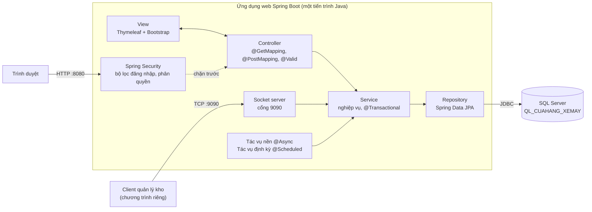
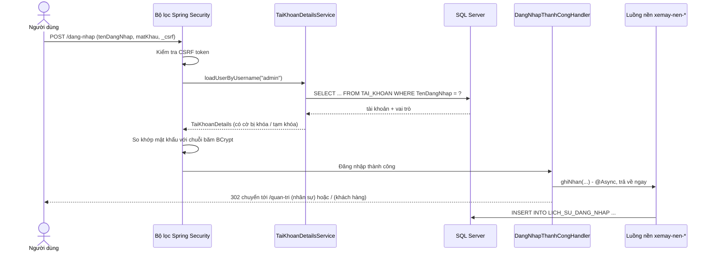
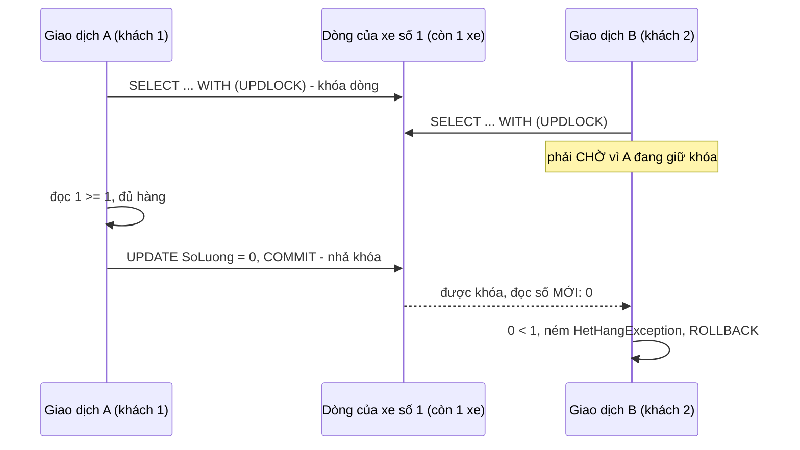
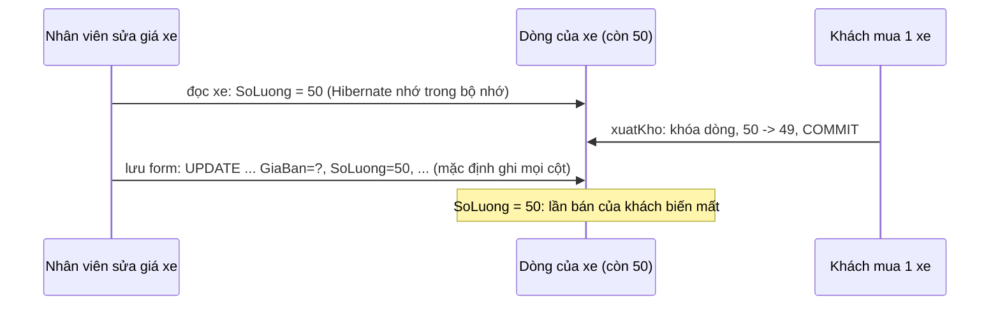
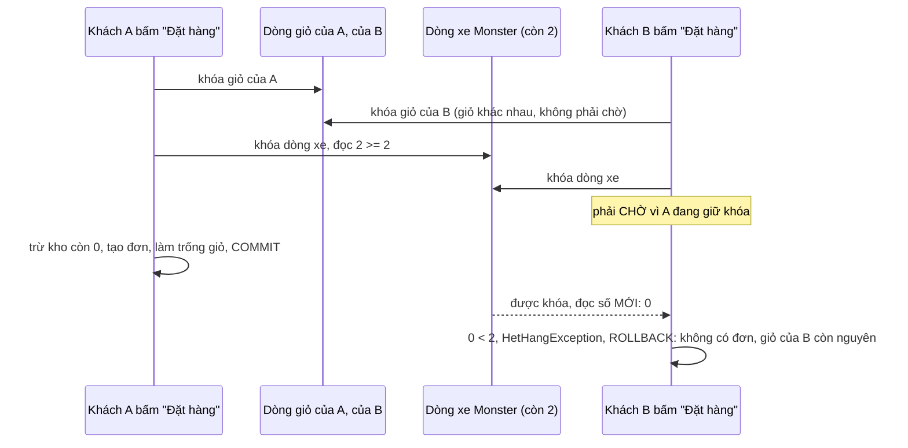
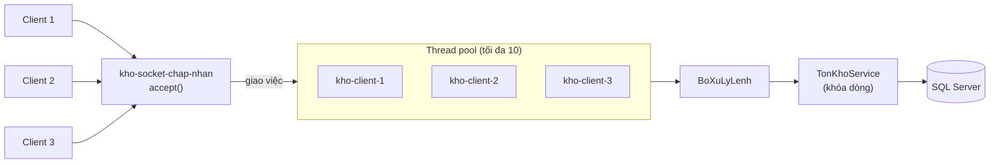

# Thiết kế phần đồng thời và phần mạng

Tài liệu dùng cho **mục 1.4** (kiến trúc, luồng xử lý một request) và **mục 1.5** (phân tích phần đồng thời và mạng)
của Chương 2 trong báo cáo. Các sơ đồ viết bằng Mermaid: GitHub hiển thị trực tiếp; muốn đưa vào Word thì dán
mã sơ đồ vào <https://mermaid.live> rồi xuất ảnh PNG.

## 1. Kiến trúc tổng thể



Socket server chạy **bên trong** ứng dụng web nên dùng lại đúng các Service (cùng quy tắc nghiệp vụ, cùng khóa dữ liệu)
và cùng cơ sở dữ liệu với trang web.

## 2. Luồng xử lý một request tiêu biểu: đăng nhập



Nếu sai mật khẩu, `DangNhapThatBaiHandler` tăng bộ đếm lần sai (sai 5 lần thì tạm khóa 15 phút), cũng ghi nhật ký bằng
luồng nền, rồi chuyển về `/dang-nhap?loi=sai`.

## 3. Phần xử lý đồng thời

### 3.1 Vì sao ứng dụng chạy đa luồng

| Nguồn | Luồng | Ghi chú |
|---|---|---|
| Mỗi request HTTP | `http-nio-8080-exec-N` (Tomcat) | Nhiều khách đặt hàng, nhiều quản trị viên thao tác cùng lúc |
| Mỗi client kết nối Socket | `kho-client-N` (thread pool của Socket server) | Nhiều nhân viên kho nhập/xuất cùng lúc |
| Ghi nhật ký đăng nhập | `xemay-nen-N` (`@Async`) | Người dùng không phải chờ câu lệnh INSERT |
| Gửi email chào mừng khách mới | `xemay-nen-N` (`@Async`, chạy sau khi giao dịch đã lưu) | Khách đăng ký không phải chờ máy chủ thư |
| Quét tồn kho, dọn dữ liệu | `xemay-dinh-ky-N` (`@Scheduled`) | Chạy song song với các luồng phục vụ người dùng |

Tên luồng được đặt trong `application.properties` (`spring.task.*`) và trong `KhoSocketServer`, nên khi demo
nhìn log là biết đoạn mã nào đang chạy trên luồng nào.

### 3.2 Tài nguyên dùng chung và cách đồng bộ

| Tài nguyên dùng chung | Ai cùng truy cập | Nếu không đồng bộ | Cách đồng bộ |
|---|---|---|---|
| Cột `SoLuong` của bảng `XE_MAY` | Luồng Tomcat (khách đặt hàng, nhân viên nhập kho trên web), luồng `kho-client-N` (nhập/xuất kho) | Mất cập nhật, bán vượt số xe đang có | **Khóa bi quan JPA** `PESSIMISTIC_WRITE` (`TonKhoService`) |
| Giỏ hàng của một khách (`GIO_HANG`, `CHI_TIET_GIO_HANG`) | Nhiều tab, nhiều lần bấm của cùng một khách: thêm, sửa, xóa, đặt hàng | Bấm "Đặt hàng" hai lần thành hai đơn, trừ kho hai lần | Khóa dòng giỏ trước mọi thao tác (`GioHangRepository.khoaTheoKhachHang`), mục 3.5 |
| Cột `SoLuong` khi nhân viên sửa thông tin xe | Luồng sửa xe và luồng bán xe | Câu UPDATE của form sửa ghi lại số tồn cũ, xóa mất lần bán xen giữa | Form sửa không nhận số lượng + `@DynamicUpdate`: UPDATE chỉ ghi cột đã đổi (mục 3.4) |
| Số điện thoại khách hàng | Hai người đăng ký, hoặc nhân viên nhập khách, cùng một số điện thoại | Hai hồ sơ trùng số | Chỉ mục `UNIQUE` của `KHACH_HANG.SoDienThoai` + bắt `DataIntegrityViolationException`; tài khoản và hồ sơ cùng một giao dịch |
| Bộ đếm đăng nhập sai (bộ nhớ) | Luồng Tomcat và luồng Socket cùng ghi nhận lần sai | Mất lần đếm, kẻ dò mật khẩu thử được nhiều hơn 5 lần | `ConcurrentHashMap.compute` - đọc, tính, ghi là **nguyên tử** (`BoDemDangNhapSai`) |
| Tên đăng nhập, email | Hai người đăng ký cùng một tên cùng lúc | Hai tài khoản trùng tên | Ràng buộc `UNIQUE` trong CSDL + bắt `DataIntegrityViolationException` (`TaiKhoanService`) |
| Số client đang phục vụ, tổng số kết nối | Các luồng `kho-client-N` | Thống kê sai | `AtomicInteger`, `AtomicLong`; tập kết nối dùng `ConcurrentHashMap.newKeySet()` |
| Kết quả quét tồn kho gần nhất | Luồng định kỳ ghi, luồng Tomcat đọc | Luồng đọc thấy dữ liệu cũ hoặc dở dang | Đối tượng **bất biến** (`record`) + biến `volatile` |

### 3.3 Chi tiết: trừ tồn kho

Thao tác trừ kho có 3 bước: **đọc** số tồn, **kiểm tra** đủ hàng, **ghi** số mới. Không khóa thì hai giao dịch có thể
xen kẽ: cùng đọc 1, cùng thấy đủ hàng, cùng ghi 0, tức là bán 2 xe trong khi kho chỉ có 1.

`TonKhoService.xuatKho` khóa dòng của xe **trước khi đọc**. Trên SQL Server, Hibernate sinh câu lệnh (lấy từ log thật):

```sql
select xm1_0.MaXe,xm1_0.GiaBan,xm1_0.MaHang,xm1_0.HinhAnh,xm1_0.LoaiXe,xm1_0.MauSac,xm1_0.MoTa,
       xm1_0.NgayTao,xm1_0.PhanKhoi,xm1_0.SoLuong,xm1_0.TenXe,xm1_0.TrangThai
from XE_MAY xm1_0 with (updlock,holdlock,rowlock)
where xm1_0.MaXe=?
-- ... kiểm tra đủ hàng, rồi khi commit:
update XE_MAY set SoLuong=? where MaXe=?
```

Khóa được giữ đến khi giao dịch kết thúc (commit hoặc rollback). Giao dịch thứ hai muốn khóa cùng dòng phải chờ,
và khi được vào thì đọc được số tồn **mới nhất**:



**Tránh deadlock** khi một đơn hàng có nhiều xe: `xuatKhoNhieuXe` luôn khóa các xe theo **mã tăng dần**. Nếu đơn A khóa
xe 1 rồi chờ xe 2, trong khi đơn B khóa xe 2 rồi chờ xe 1, hai bên sẽ chờ nhau mãi; khi mọi giao dịch khóa theo cùng một
thứ tự thì vòng chờ này không thể xảy ra. Bài kiểm thử `xuatNhieuXeKhongDeadlock` chứng minh điều đó.

**Chốt chặn cuối:** cột `SoLuong` có ràng buộc `CK_XEMAY_SOLUONG CHECK(SoLuong >= 0)` trong script của nhóm.

**Procedure xác nhận đơn không trừ kho nữa:** kho đã bị trừ ngay lúc khách đặt hàng (mục 3.5). Bản gốc của
`sp_XacNhanDonHang` trừ kho khi xác nhận, nếu giữ nguyên thì đơn đặt trên web bị trừ kho hai lần; phần trừ kho trong
procedure đã được đặt trong chú thích (đánh dấu `[Tich hop]`). Procedure vẫn khóa dòng đơn hàng bằng `WITH(UPDLOCK,HOLDLOCK)`:
hai nhân viên cùng xác nhận một đơn thì người sau nhận lỗi "Đơn hàng không ở trạng thái chờ xác nhận.", không có hai hóa đơn.

### 3.4 Sửa thông tin xe trong lúc có người mua (lỗi phát hiện khi tích hợp)

Form sửa xe của phần quản lý xe máy ban đầu gán lại `SoLuong` lấy từ form. Bỏ dòng đó vẫn **chưa đủ**: mặc định Hibernate
sinh câu UPDATE ghi lại **mọi** cột của đối tượng, kể cả `SoLuong` đã đọc từ lúc mở form.



Cách sửa: thêm `@DynamicUpdate` cho Entity `XeMay`. Hibernate so sánh với lúc đọc và chỉ ghi các cột đã đổi; log thật khi
nhân viên đổi giá xe là `update XE_MAY set GiaBan=? where MaXe=?`, không còn đụng tới `SoLuong`. Bài kiểm thử
`suaXeTrongLucCoNguoiMua` tái hiện đúng trình tự trên: có `@DynamicUpdate` thì còn 49 (đúng), bỏ đi thì còn 50 (sai).
Muốn tăng tồn kho thì dùng nút **Nhập kho** trên trang sửa xe, đi qua `TonKhoService` như mọi thao tác kho khác.

### 3.5 Đặt hàng: khóa giỏ trước, khóa xe sau

`DatHangService.datHang` làm mọi bước trong **một** giao dịch: khóa dòng giỏ của khách, khóa và trừ kho từng xe
(`TonKhoService.xuatKhoNhieuXe`, mã xe tăng dần), tạo `DON_HANG` và `CHI_TIET_DON_HANG` theo giá bán hiện tại, làm trống giỏ.
Thiếu hàng ở bất kỳ xe nào thì cả giao dịch bị hủy: không tạo đơn, không trừ xe nào, giỏ của khách còn nguyên.
Đơn mới ở trạng thái `CHO_XAC_NHAN` và đã giữ xe cho khách (kho đã trừ); hủy đơn thì trả lại bằng `TonKhoService.nhapKho`.

Hai khách cùng đặt chiếc xe cuối cùng (kiểm thử `haiKhachCungDatChiecXeCuoi`, và chạy thật trên giao diện, ảnh `28-hai-khach-cung-dat.jpg`):



Một khách bấm "Đặt hàng" hai lần liên tiếp (hoặc đặt ở hai tab): lần sau chờ khóa dòng giỏ, đến lượt thì giỏ đã trống, nhận
"Giỏ hàng đang trống." (kiểm thử `motKhachDatHaiLanCungLuc`: một đơn, kho chỉ trừ một lần).

**Thứ tự khóa chung để không deadlock:** giao dịch nào cần cả giỏ và kho thì khóa giỏ trước, các xe sau (theo mã tăng dần).
Thêm, sửa, xóa trong giỏ chỉ khóa giỏ; nhập/xuất kho từ client và trang quản trị chỉ khóa xe. Không giao dịch nào giữ khóa xe
rồi mới xin khóa giỏ, nên không thể có vòng chờ.

**Lỗi treo phát hiện khi chạy trên SQL Server:** khách mới (chưa có dòng `GIO_HANG`) bấm "Thêm vào giỏ" lần đầu thì trang
quay mãi không xong. Bản đầu tiên khóa giỏ trước (`SELECT ... WITH (UPDLOCK, HOLDLOCK, ROWLOCK) WHERE MaKhachHang = ?`), không
thấy dòng nào thì tạo giỏ trong một giao dịch riêng (`REQUIRES_NEW`). Với `HOLDLOCK`, khi dòng chưa tồn tại SQL Server khóa cả
**khoảng** chỉ mục nơi dòng đó sẽ nằm, nên lệnh INSERT của giao dịch riêng phải chờ giao dịch ngoài, trong khi giao dịch ngoài
lại đang chờ giao dịch riêng chạy xong. SQL Server không nhận ra đây là deadlock vì một đầu của vòng chờ nằm trong Java.
Lúc treo, `sys.dm_tran_locks` cho thấy đúng như vậy:

```
request_session_id resource_type request_mode request_status
60                 KEY           RangeS-U     GRANT     -- giao dịch ngoài: khóa khoảng chỉ mục
59                 KEY           RangeI-N     WAIT      -- giao dịch riêng: INSERT GIO_HANG đang chờ
```

Kiểm thử trên H2 không bắt được lỗi này vì H2 không khóa khoảng chỉ mục. Cách sửa (`GioHangService.khoaGio`): kiểm tra giỏ
bằng câu đọc thường (không khóa), chưa có thì tạo giỏ trong giao dịch riêng **trước**, sau đó mới khóa dòng giỏ đã tồn tại.
Hai yêu cầu cùng tạo giỏ cho một khách thì ràng buộc `UNIQUE` của `GIO_HANG.MaKhachHang` chặn lần chèn thứ hai
(log có dòng `Violation of UNIQUE KEY constraint` của Hibernate), yêu cầu đó dùng luôn giỏ vừa tạo. Sau khi sửa: khách mới thêm
xe lần đầu mất khoảng 0,3 giây; ba tab cùng thêm xe lần đầu tạo đúng một giỏ có ba dòng; 73/73 bài kiểm thử đạt trên SQL Server 2025.

### 3.6 Tác vụ nền và tác vụ định kỳ

| Tác vụ | Cơ chế | Lịch chạy | Lớp |
|---|---|---|---|
| Ghi nhật ký đăng nhập | `@Async` | Mỗi lần đăng nhập (web và Socket) | `LichSuDangNhapService.ghiNhan` |
| Gửi email chào mừng khách mới (giả lập) | `@Async` + `@TransactionalEventListener(AFTER_COMMIT)` | Mỗi khi có hồ sơ khách hàng mới, sau khi giao dịch đã lưu | `GuiEmailService.guiEmailChaoMung` |
| Quét xe sắp hết hàng (còn ≤ 3 xe), hiện trên trang Quản trị | `@Scheduled(fixedDelay)` | Mỗi 60 giây | `TacVuDinhKy.quetTonKho` |
| Dọn bộ đếm đăng nhập sai đã hết hạn | `@Scheduled(fixedDelay)` | Mỗi 5 phút | `TacVuDinhKy.donBoDemDangNhapSai` |
| Xóa nhật ký đăng nhập cũ hơn 90 ngày | `@Scheduled(cron)` | 02:00 hằng ngày | `TacVuDinhKy.donLichSuDangNhapCu` |

Log thật khi đăng nhập (luồng xử lý request giao việc cho luồng nền):

```
[http-nio-8080-exec-3] Đăng nhập thành công: 'admin' qua WEB [luồng xử lý: http-nio-8080-exec-3] -> giao việc ghi lịch sử cho luồng nền
[    xemay-nen-1] Đã ghi lịch sử đăng nhập (thành công) qua WEB [luồng nền: xemay-nen-1]
[    xemay-nen-1] Đã gửi email chào mừng tới Lê Thị Khách Mới <khachmoi01@gmail.com> [luồng: xemay-nen-1]
[xemay-dinh-ky-1] CẢNH BÁO TỒN KHO: 2 xe còn từ 3 chiếc trở xuống: Ducati Monster (còn 2), Triumph Trident 660 (còn 3) [luồng: xemay-dinh-ky-1]
```

Email chào mừng chỉ được gửi **sau khi** giao dịch tạo khách hàng đã lưu xong: nếu giao dịch bị hủy (ví dụ trùng số điện thoại)
thì không có thư nào được gửi cho một khách hàng không tồn tại.

## 4. Phần lập trình mạng

### 4.1 Mô hình client/server

- **Server:** `KhoSocketServer` mở `ServerSocket` ở cổng 9090 khi ứng dụng web khởi động, đóng khi ứng dụng tắt.
  Một luồng `kho-socket-chap-nhan` chỉ chờ `accept()`; mỗi kết nối mới được giao cho một luồng `kho-client-N`
  trong thread pool (tối đa 10 client cùng lúc, cấu hình bằng `xemay.socket.so-client-toi-da`).
- **Client:** `KhoClient` (thư mục `client/`) là chương trình Java riêng, chỉ dùng `java.net.Socket`.
  Dữ liệu client xem và thay đổi chính là dữ liệu trong SQL Server của ứng dụng web.



### 4.2 Giao thức trao đổi

Dạng văn bản, mã hóa UTF-8, mỗi thông điệp là một dòng. Client gửi `LỆNH tham_số...`; server trả lời
`OK n` kèm đúng `n` dòng dữ liệu (các cột cách nhau bằng `|`), hoặc `ERR mã thông_báo`.

| Lệnh | Ý nghĩa | Dữ liệu trả về khi thành công |
|---|---|---|
| `DANGNHAP <tên> <mật khẩu>` | Đăng nhập (chỉ quản trị viên, nhân viên) | `họ tên\|vai trò` |
| `DSXE [từ khóa]` | Danh sách xe (lọc theo tên xe hoặc tên hãng) | mỗi xe một dòng: `mã\|hãng và tên xe\|giá bán\|tồn kho` |
| `TONKHO <mã xe>` | Xem tồn kho một xe | `mã\|tên xe\|giá bán\|tồn kho` |
| `NHAPKHO <mã xe> <số lượng>` | Cộng tồn kho | thông tin xe sau khi cộng |
| `XUATKHO <mã xe> <số lượng>` | Trừ tồn kho | thông tin xe sau khi trừ |
| `THOAT` | Kết thúc | `OK 0`, server đóng kết nối |

| Mã lỗi | Ý nghĩa |
|---|---|
| 400 | Sai cú pháp, tham số không hợp lệ, lệnh lạ, dòng quá dài |
| 401 | Chưa đăng nhập hoặc đăng nhập sai |
| 403 | Vai trò không được dùng client kho (khách hàng) |
| 404 | Không tìm thấy xe |
| 408 | Client im lặng quá thời gian chờ (300 giây) |
| 409 | Không đủ hàng để xuất |
| 500 | Lỗi máy chủ |
| 503 | Server đã đủ số client tối đa |

Ví dụ một phiên làm việc (`>` client gửi, `<` server trả lời):

```
< OK 1
< XEMAY-KHO/1.0 - Hãy đăng nhập: DANGNHAP <tên đăng nhập> <mật khẩu>
> DANGNHAP nhanvien1 123456
< OK 1
< Lê Văn Hùng|NHANVIEN
> DSXE ducati
< OK 1
< 15|Ducati Monster|400000000|2
> XUATKHO 15 5
< ERR 409 Xe "Ducati Monster" chỉ còn 2 chiếc, không đủ số lượng yêu cầu (5).
> XUATKHO 15 1
< OK 1
< 15|Ducati Monster|400000000|1
> NHAPKHO 15 1
< OK 1
< 15|Ducati Monster|400000000|2
> THOAT
< OK 0
```

### 4.3 Xử lý lỗi kết nối và đóng tài nguyên

- Mọi `Socket`, luồng đọc, luồng ghi đều mở trong **try-with-resources**, nên luôn được đóng kể cả khi có lỗi.
- Client tắt ngang hoặc mất mạng: server bắt `IOException`, ghi log, giải phóng luồng cho client khác.
- Client im lặng quá 300 giây (`setSoTimeout`): server gửi `ERR 408` rồi đóng kết nối.
- Dòng lệnh dài quá 512 ký tự: server báo lỗi và ngắt, tránh bị gửi dữ liệu khổng lồ làm cạn bộ nhớ.
- Đăng nhập sai 3 lần trong một kết nối: server ngắt kết nối. Bộ đếm sai 5 lần thì tạm khóa dùng **chung** với trang web.
- Server đầy (đủ 10 client): kết nối mới nhận `ERR 503` rồi bị đóng, server không tạo thêm luồng vô hạn.
- Ứng dụng tắt: `stop()` đóng `ServerSocket` và mọi kết nối đang mở, chờ thread pool kết thúc tối đa 5 giây.
- Phía client: không kết nối được, server không trả lời, server đóng kết nối đều có thông báo tiếng Việt dễ hiểu.
