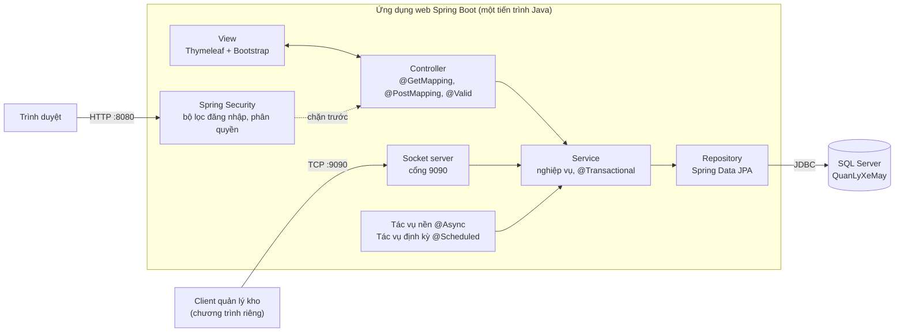
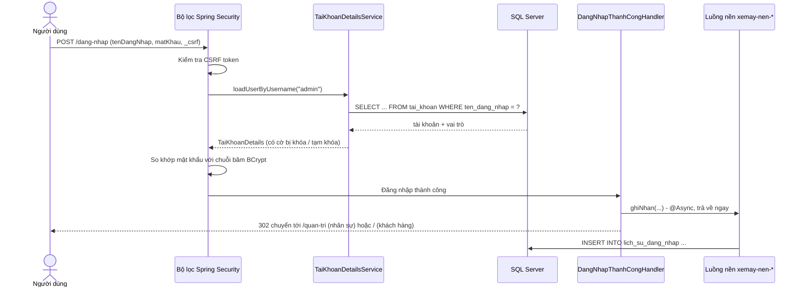
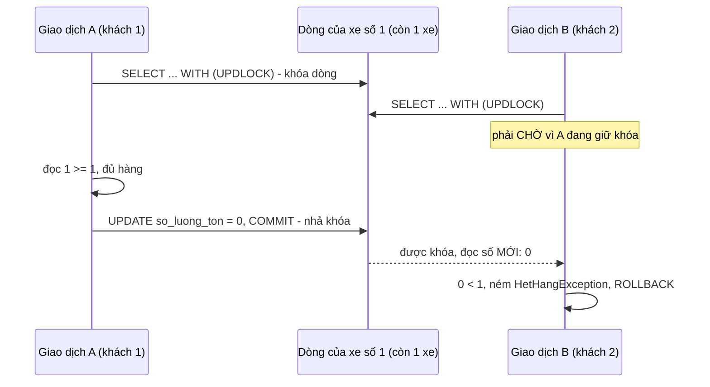
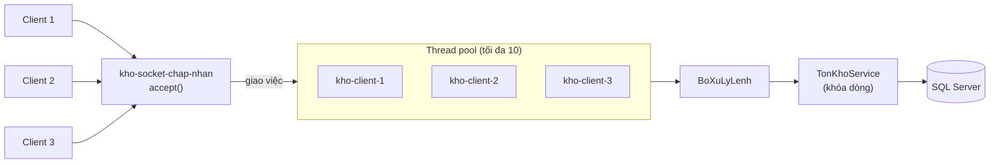

# Thiết kế phần đồng thời và phần mạng

Tài liệu dùng cho **mục 1.4** (kiến trúc, luồng xử lý một request) và **mục 1.5** (phân tích phần đồng thời và mạng)
của Chương 2 trong báo cáo. Các sơ đồ viết bằng Mermaid: GitHub hiển thị trực tiếp; muốn đưa vào Word thì dán
mã sơ đồ vào <https://mermaid.live> rồi xuất ảnh PNG.

## 1. Kiến trúc tổng thể



Socket server chạy **bên trong** ứng dụng web nên dùng lại đúng các Service (cùng quy tắc nghiệp vụ, cùng khóa dữ liệu)
và cùng cơ sở dữ liệu với trang web.

## 2. Luồng xử lý một request tiêu biểu: đăng nhập



Nếu sai mật khẩu, `DangNhapThatBaiHandler` tăng bộ đếm lần sai (sai 5 lần thì tạm khóa 15 phút), cũng ghi nhật ký bằng
luồng nền, rồi chuyển về `/dang-nhap?loi=sai`.

## 3. Phần xử lý đồng thời

### 3.1 Vì sao ứng dụng chạy đa luồng

| Nguồn | Luồng | Ghi chú |
|---|---|---|
| Mỗi request HTTP | `http-nio-8080-exec-N` (Tomcat) | Nhiều khách đặt hàng, nhiều quản trị viên thao tác cùng lúc |
| Mỗi client kết nối Socket | `kho-client-N` (thread pool của Socket server) | Nhiều nhân viên kho nhập/xuất cùng lúc |
| Ghi nhật ký đăng nhập | `xemay-nen-N` (`@Async`) | Người dùng không phải chờ câu lệnh INSERT |
| Quét tồn kho, dọn dữ liệu | `xemay-dinh-ky-N` (`@Scheduled`) | Chạy song song với các luồng phục vụ người dùng |

Tên luồng được đặt trong `application.properties` (`spring.task.*`) và trong `KhoSocketServer`, nên khi demo
nhìn log là biết đoạn mã nào đang chạy trên luồng nào.

### 3.2 Tài nguyên dùng chung và cách đồng bộ

| Tài nguyên dùng chung | Ai cùng truy cập | Nếu không đồng bộ | Cách đồng bộ |
|---|---|---|---|
| Cột `so_luong_ton` của bảng `xe_may` | Luồng Tomcat (đặt hàng), luồng `kho-client-N` (nhập/xuất kho) | Mất cập nhật, bán vượt số xe đang có | **Khóa bi quan JPA** `PESSIMISTIC_WRITE` (`TonKhoService`) |
| Bộ đếm đăng nhập sai (bộ nhớ) | Luồng Tomcat và luồng Socket cùng ghi nhận lần sai | Mất lần đếm, kẻ dò mật khẩu thử được nhiều hơn 5 lần | `ConcurrentHashMap.compute` - đọc, tính, ghi là **nguyên tử** (`BoDemDangNhapSai`) |
| Tên đăng nhập, email | Hai người đăng ký cùng một tên cùng lúc | Hai tài khoản trùng tên | Ràng buộc `UNIQUE` trong CSDL + bắt `DataIntegrityViolationException` (`TaiKhoanService`) |
| Số client đang phục vụ, tổng số kết nối | Các luồng `kho-client-N` | Thống kê sai | `AtomicInteger`, `AtomicLong`; tập kết nối dùng `ConcurrentHashMap.newKeySet()` |
| Kết quả quét tồn kho gần nhất | Luồng định kỳ ghi, luồng Tomcat đọc | Luồng đọc thấy dữ liệu cũ hoặc dở dang | Đối tượng **bất biến** (`record`) + biến `volatile` |

### 3.3 Chi tiết: trừ tồn kho

Thao tác trừ kho có 3 bước: **đọc** số tồn, **kiểm tra** đủ hàng, **ghi** số mới. Không khóa thì hai giao dịch có thể
xen kẽ: cùng đọc 1, cùng thấy đủ hàng, cùng ghi 0, tức là bán 2 xe trong khi kho chỉ có 1.

`TonKhoService.xuatKho` khóa dòng của xe **trước khi đọc**. Trên SQL Server, Hibernate sinh câu lệnh:

```sql
select xm1_0.id, xm1_0.gia_ban, xm1_0.so_luong_ton, xm1_0.ten_xe
from xe_may xm1_0 with (updlock, holdlock, rowlock)
where xm1_0.id = ?
```

Khóa được giữ đến khi giao dịch kết thúc (commit hoặc rollback). Giao dịch thứ hai muốn khóa cùng dòng phải chờ,
và khi được vào thì đọc được số tồn **mới nhất**:



**Tránh deadlock** khi một đơn hàng có nhiều xe: `xuatKhoNhieuXe` luôn khóa các xe theo **mã tăng dần**. Nếu đơn A khóa
xe 1 rồi chờ xe 2, trong khi đơn B khóa xe 2 rồi chờ xe 1, hai bên sẽ chờ nhau mãi; khi mọi giao dịch khóa theo cùng một
thứ tự thì vòng chờ này không thể xảy ra. Bài kiểm thử `xuatNhieuXeKhongDeadlock` chứng minh điều đó.

**Chốt chặn cuối:** cột `so_luong_ton` có ràng buộc `CHECK (so_luong_ton >= 0)` trong CSDL.

### 3.4 Tác vụ nền và tác vụ định kỳ

| Tác vụ | Cơ chế | Lịch chạy | Lớp |
|---|---|---|---|
| Ghi nhật ký đăng nhập | `@Async` | Mỗi lần đăng nhập (web và Socket) | `LichSuDangNhapService.ghiNhan` |
| Quét xe sắp hết hàng (còn ≤ 3 xe), hiện trên trang Quản trị | `@Scheduled(fixedDelay)` | Mỗi 60 giây | `TacVuDinhKy.quetTonKho` |
| Dọn bộ đếm đăng nhập sai đã hết hạn | `@Scheduled(fixedDelay)` | Mỗi 5 phút | `TacVuDinhKy.donBoDemDangNhapSai` |
| Xóa nhật ký đăng nhập cũ hơn 90 ngày | `@Scheduled(cron)` | 02:00 hằng ngày | `TacVuDinhKy.donLichSuDangNhapCu` |

Log thật khi đăng nhập (luồng xử lý request giao việc cho luồng nền):

```
[http-nio-8080-exec-3] Đăng nhập thành công: 'admin' qua WEB [luồng xử lý: http-nio-8080-exec-3] -> giao việc ghi lịch sử cho luồng nền
[    xemay-nen-1] Đã ghi lịch sử đăng nhập (thành công) qua WEB [luồng nền: xemay-nen-1]
[xemay-dinh-ky-1] CẢNH BÁO TỒN KHO: 3 xe còn từ 3 chiếc trở xuống: Piaggio Vespa Sprint 125 (còn 1), ...
```

## 4. Phần lập trình mạng

### 4.1 Mô hình client/server

- **Server:** `KhoSocketServer` mở `ServerSocket` ở cổng 9090 khi ứng dụng web khởi động, đóng khi ứng dụng tắt.
  Một luồng `kho-socket-chap-nhan` chỉ chờ `accept()`; mỗi kết nối mới được giao cho một luồng `kho-client-N`
  trong thread pool (tối đa 10 client cùng lúc, cấu hình bằng `xemay.socket.so-client-toi-da`).
- **Client:** `KhoClient` (thư mục `client/`) là chương trình Java riêng, chỉ dùng `java.net.Socket`.
  Dữ liệu client xem và thay đổi chính là dữ liệu trong SQL Server của ứng dụng web.



### 4.2 Giao thức trao đổi

Dạng văn bản, mã hóa UTF-8, mỗi thông điệp là một dòng. Client gửi `LỆNH tham_số...`; server trả lời
`OK n` kèm đúng `n` dòng dữ liệu (các cột cách nhau bằng `|`), hoặc `ERR mã thông_báo`.

| Lệnh | Ý nghĩa | Dữ liệu trả về khi thành công |
|---|---|---|
| `DANGNHAP <tên> <mật khẩu>` | Đăng nhập (chỉ quản trị viên, nhân viên) | `họ tên\|vai trò` |
| `DSXE [từ khóa]` | Danh sách xe (lọc theo tên) | mỗi xe một dòng: `mã\|tên xe\|giá bán\|tồn kho` |
| `TONKHO <mã xe>` | Xem tồn kho một xe | `mã\|tên xe\|giá bán\|tồn kho` |
| `NHAPKHO <mã xe> <số lượng>` | Cộng tồn kho | thông tin xe sau khi cộng |
| `XUATKHO <mã xe> <số lượng>` | Trừ tồn kho | thông tin xe sau khi trừ |
| `THOAT` | Kết thúc | `OK 0`, server đóng kết nối |

| Mã lỗi | Ý nghĩa |
|---|---|
| 400 | Sai cú pháp, tham số không hợp lệ, lệnh lạ, dòng quá dài |
| 401 | Chưa đăng nhập hoặc đăng nhập sai |
| 403 | Vai trò không được dùng client kho (khách hàng) |
| 404 | Không tìm thấy xe |
| 408 | Client im lặng quá thời gian chờ (300 giây) |
| 409 | Không đủ hàng để xuất |
| 500 | Lỗi máy chủ |
| 503 | Server đã đủ số client tối đa |

Ví dụ một phiên làm việc (`>` client gửi, `<` server trả lời):

```
< OK 1
< XEMAY-KHO/1.0 - Hãy đăng nhập: DANGNHAP <tên đăng nhập> <mật khẩu>
> DANGNHAP nhanvien 123456
< OK 1
< Nhân viên bán hàng|NHANVIEN
> XUATKHO 4 5
< ERR 409 Xe "Honda Winner X" chỉ còn 3 chiếc, không đủ số lượng yêu cầu (5).
> XUATKHO 4 1
< OK 1
< 4|Honda Winner X|46160000|2
> THOAT
< OK 0
```

### 4.3 Xử lý lỗi kết nối và đóng tài nguyên

- Mọi `Socket`, luồng đọc, luồng ghi đều mở trong **try-with-resources**, nên luôn được đóng kể cả khi có lỗi.
- Client tắt ngang hoặc mất mạng: server bắt `IOException`, ghi log, giải phóng luồng cho client khác.
- Client im lặng quá 300 giây (`setSoTimeout`): server gửi `ERR 408` rồi đóng kết nối.
- Dòng lệnh dài quá 512 ký tự: server báo lỗi và ngắt, tránh bị gửi dữ liệu khổng lồ làm cạn bộ nhớ.
- Đăng nhập sai 3 lần trong một kết nối: server ngắt kết nối. Bộ đếm sai 5 lần thì tạm khóa dùng **chung** với trang web.
- Server đầy (đủ 10 client): kết nối mới nhận `ERR 503` rồi bị đóng, server không tạo thêm luồng vô hạn.
- Ứng dụng tắt: `stop()` đóng `ServerSocket` và mọi kết nối đang mở, chờ thread pool kết thúc tối đa 5 giây.
- Phía client: không kết nối được, server không trả lời, server đóng kết nối đều có thông báo tiếng Việt dễ hiểu.
